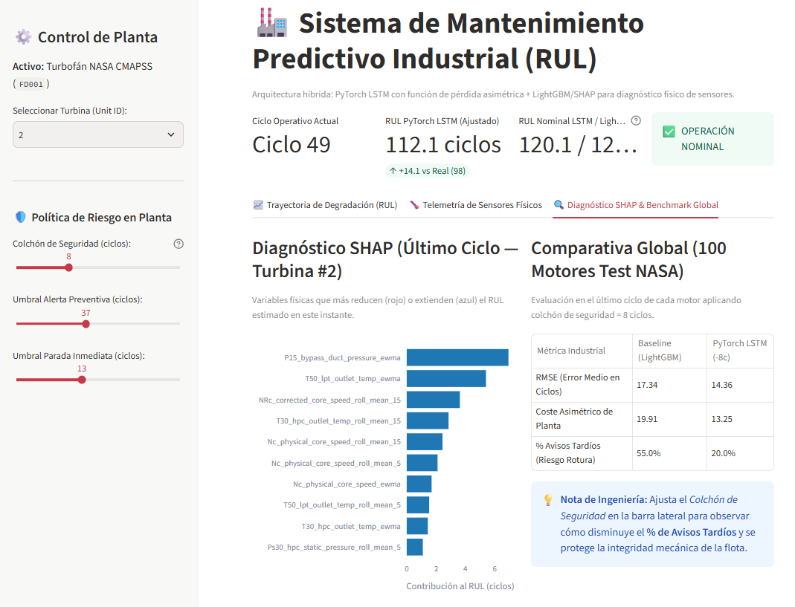

# ⚙️ Industrial Predictive Maintenance (RUL Estimation) — NASA CMAPSS

Sistema de mantenimiento predictivo *end-to-end* para activos rotativos críticos (turbofanes) basado en telemetría multivariante de sensores. Combina **Deep Learning secuencial (PyTorch LSTM)** con una **función de pérdida asimétrica orientada a costes de planta** y explicabilidad física mediante **LightGBM + SHAP**.



---

## 🎯 Problema de Negocio y Criterio de Ingeniería

En entornos de manufactura continua y energía, los errores de predicción de Vida Útil Remanente (**RUL**, *Remaining Useful Life*) no tienen el mismo coste:
* **Aviso Temprano ($\hat{y} < y$):** Genera una parada de mantenimiento preventivo planificada (coste operativo bajo y controlado).
* **Aviso Tardío ($\hat{y} > y$):** El equipo falla en operación antes de la intervención prevista, provocando paradas no planificadas, daños secundarios y pérdida de producción (coste elevado).

Este proyecto sustituye el entrenamiento simétrico tradicional por una **función de pérdida diferenciable asimétrica (`AsymmetricMSELoss`)** en PyTorch que penaliza **2.0x** las predicciones tardías, acoplada a un **colchón de seguridad configurable** en la interfaz operativa.

---

## 📊 Resultados en Benchmark (NASA CMAPSS FD001 — 100 Motores Test)

Evaluación realizada sobre el último ciclo operativo registrado de cada turbina del conjunto de prueba oficial:

| Modelo | Arquitectura / Enfoque | RMSE (Ciclos) | Coste Asimétrico de Planta | Mejora vs. Baseline |
| :--- | :--- | :---: | :---: | :---: |
| **Baseline Tabular** | LightGBM + Rolling Stats / EWMA | `17.34` | `19.91` | — |
| **Deep Learning (Core)** | **PyTorch LSTM (2 capas, seq=30) + Asymmetric Loss** | **`12.70`** | **`14.69`** | **-26.8% RMSE / -26.2% Coste** |

---

## 🏗️ Arquitectura y Rigor Técnico (Zero Data Leakage)

1. **Auditoría Física de Sensores (`src/data_loader.py`):** Detección y descarte automático de 6 sensores constantes sin varianza en régimen operativo `FD001`, conservando 15 señales físicas activas y aplicando *Piecewise RUL* (`cap = 125` ciclos) para modelar la degradación real tras el periodo nominal.
2. **Ingeniería de Características sin Fuga (`src/features.py`):**
   * División estricta train/validación por ID de motor (`80 / 20 motores`), nunca por filas aleatorias.
   * Escalado `MinMaxScaler` ajustado exclusivamente sobre entrenamiento.
   * Ventanas móviles hacia atrás (`rolling` 5 y 15 ciclos) y suavizado exponencial (`EWMA`) para filtrar ruido de instrumentación.
3. **Suite de Tests Automatizados (`tests/test_leakage.py`):** Validación continua con `pytest` que garantiza cero solapamiento de activos, ausencia de fuga temporal hacia el futuro y comportamiento matemático de la pérdida asimétrica.
4. **Consola Operativa (`app/dashboard.py`):** Aplicación interactiva en **Streamlit + Plotly** con ajuste dinámico de umbral de riesgo, telemetría de sensores y diagnóstico de degradación por sensor mediante **SHAP**.

---

## 🚀 Estructura del Proyecto

```text
PREDICTIVE_MAINTENANCE_CMAPSS/
├── app/
│   └── dashboard.py          # Consola operativa en Streamlit + Plotly + SHAP
├── configs/
│   └── config.yaml           # Parámetros físicos, ventanas, semillas y penalizaciones
├── data/
│   ├── raw/                  # Archivos originales NASA CMAPSS (ignorados en Git)
│   └── processed/            # Datasets Parquet y tensores NPZ (ignorados en Git)
├── docs/
│   └── dashboard_overview.png
├── models/                   # Artefactos entrenados .pt y .joblib (ignorados en Git)
├── src/
│   ├── data_loader.py        # Ingesta, nombres físicos y auditoría de varianza
│   ├── features.py           # Feature engineering temporal y secuencias 3D
│   ├── train_baseline.py     # Modelo de referencia LightGBM + métrica de planta
│   └── train_dl.py           # Red neuronal PyTorch LSTM + AsymmetricMSELoss
├── tests/
│   └── test_leakage.py       # Tests unitarios de integridad física y cero leakage
└── requirements.txt
